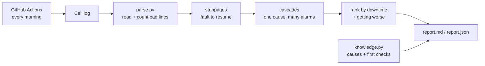

# RoboTriage

[](https://github.com/rafiasimran/robotriage/actions/workflows/tests.yml) [](https://github.com/rafiasimran/robotriage/actions/workflows/triage.yml)

Automatic fault triage for a robot cell. It reads a week of machine logs and answers the three questions a maintenance team asks every Monday: **what stopped us, what actually caused it, and what should we fix first?**

**[→ Latest report](reports/report.md)**, regenerated every morning by GitHub Actions.

## The problem

When something goes wrong on a production line, the screen fills with alarms. A short voltage dip at the cell controller can make three robots report network timeouts within seconds. Each alarm looks like its own problem, so people end up checking network cables when the real cause was the power supply.

Slow problems hide in the opposite way. A suction cup wearing out causes one short stop on Monday and six on Sunday. No single stop looks serious, but together it's the biggest loss of the week.

Engineers usually find these patterns by scrolling through logs by hand. RoboTriage does that part automatically.

## What it does

1. **Reads the log** and skips garbled lines, but counts them so the report says how much couldn't be read.
2. **Finds every stoppage**: from the fault to the moment the machine was back in automatic mode. A second alarm on a machine that is already stopped isn't counted twice.
3. **Groups chains of faults**: when a fault that can spread (a power dip or a bus timeout) is followed within 10 seconds by stops on other machines, they are treated as one event with that fault as the root cause.
4. **Charges downtime to the root cause.** A network timeout caused by a power dip counts as power downtime.
5. **Ranks problems by production time lost** and adds first checks for the top one from a small fault knowledge base.
6. **Flags problems that are getting worse**, comparing the first and second half of the period.
7. **Writes a report** in Markdown and JSON.



## Example: what it found in the sample week

Simulated week of 19–25 Oct 2026, 4,158 log lines. You get exactly this week with the default settings of the simulator (seed 7):

| # | Fault | Where | Times | Downtime |
|---|---|---|---|---|
| 1 | Gripper vacuum below threshold | R2 | 26 | 2 h 37 min |
| 2 | Supply voltage dip | PLC | 2 | 1 h 43 min, of which 1 h 38 min on other robots |
| 3 | Joint 3 over-temperature | R4 | 3 | 1 h 28 min |

- The two voltage dips each triggered fieldbus timeouts on R1, R3 and R4 within 4 seconds. Counted separately, those timeouts would look like a network problem. RoboTriage reports them as **two power events**.
- R2's gripper faults went from 8 in the first half of the week to 18 in the second half. The report flags it as **getting worse** and suggests checking the suction cup and vacuum line.

## Run it

Python 3.10+ and no extra packages needed to run it (pytest for the tests).

```bash
python -m robotriage.simulate logs/cell_week.log      # make a sample week
python -m robotriage logs/cell_week.log --out reports  # triage it
pytest -q
```

Options: `--window 10` sets how many seconds apart faults can be to count as one chain. The simulator takes `--start`, `--days` and `--seed`.

## Automation

- **Tests** run on every push.
- **Daily triage** runs every morning at 05:30 UTC. If there's a `.log` file in `logs/`, it triages the newest one. If not, it simulates the last 7 days and triages that. The new report is committed back to the repo. Dropping a log file into `logs/` and pushing also triggers a run.

## Tests

15 tests. The unit tests cover the tricky cases one by one: double faults on a stopped machine, a missing RESUME line, a stop that never ends, a real chain versus two faults that just happen close together. The end-to-end test generates a full week and checks that the pipeline finds every problem hidden in it, for several random seeds.

## Project structure

```
robotriage/
  parse.py       read log lines, count broken ones
  triage.py      stoppages, cascades, ranking, trends, availability
  knowledge.py   fault codes: meaning, likely causes, first checks
  report.py      Markdown + JSON report
  simulate.py    realistic week of logs with known problems hidden in it
  __main__.py    command line entry point
tests/
reports/         latest report (updated by GitHub Actions)
```

## Design decisions

- **Downtime goes to the root cause.** Otherwise the team fixes the symptom (cables) and the cause (power) keeps coming back.
- **If a RESUME line is missing, the stop ends at the machine's next cycle report.** Without this, one lost line in the log would count days of downtime. The report says how many ends were inferred this way.
- **Timing alone is not proof of cause.** The first version grouped any faults that happened within 10 seconds, and a daily report blamed a light curtain trip on one robot for a gripper fault on the next. Now only faults that can actually spread through the cell start a chain, and a test covers that exact case.
- **The trend check is simple on purpose:** split the period in half and compare counts. It's easy to explain and hard to fool with one bad day.
- **Standard library only.** It should run on any machine in a plant without installing anything.

## Limitations

- **The logs are simulated.** Real controller logs are confidential, so `simulate.py` writes the kind of log a cell like this produces, with known problems hidden in it. Fault codes are generic examples, not a specific robot vendor's codes. A real controller export would need a small adapter in `parse.py`.
- Which faults can start a chain is a fixed list (`CAN_CASCADE` in `knowledge.py`). With real data I'd learn it from history: which faults are often followed by stops elsewhere.
- Availability is based on fault stops only, not planned breaks or changeovers.

## Next steps

- An adapter for a real controller log format
- Mean time between failures per machine and fault
- The same approach for other fault logs, such as wind turbine or solar inverter alarms

## Tech

Python · pytest · GitHub Actions

---

Built by **Rafia Imran** · [GitHub profile](https://github.com/rafiasimran)
